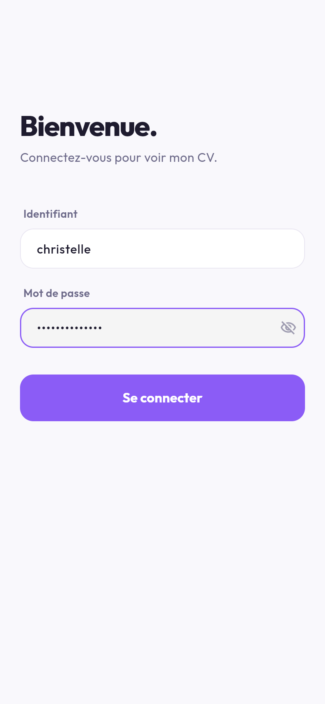
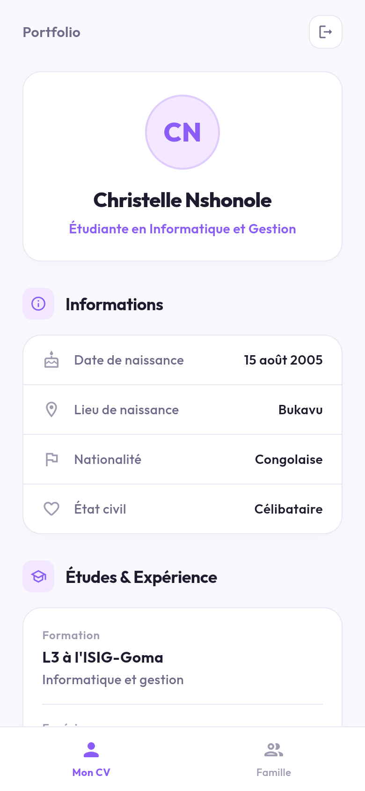
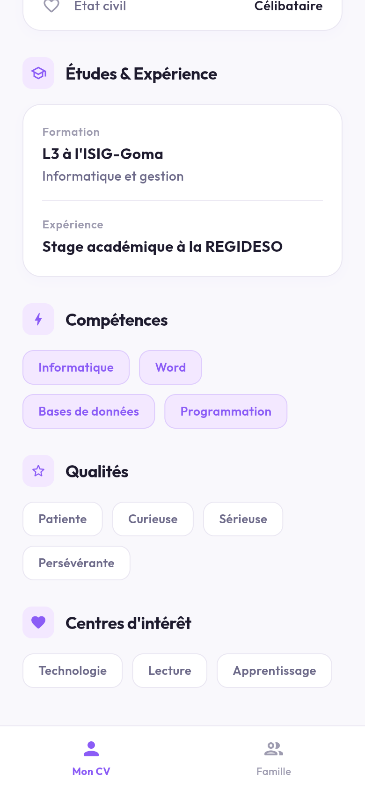
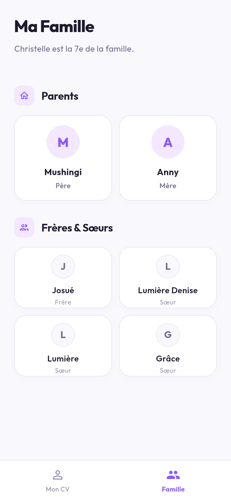

# CV Flutter – Christelle Nshonole

Application mobile Flutter qui présente mon CV et ma famille.
L'accès à l'application se fait par une page de connexion.

## Fonctionnalités

- **Connexion** : formulaire avec identifiant, mot de passe masqué (affichable via l'icône œil) et bouton « Se connecter ».
- **Mon CV** : nom, titre, informations personnelles, études & expérience, compétences, qualités et centres d'intérêt.
- **Famille** : mes parents et mes frères & sœurs avec leur nom et leur lien de parenté, affichés sous forme de cartes.
- **Navigation** : une barre de navigation en bas de l'écran (Mon CV, Famille) et un bouton de déconnexion.

## Identifiants de test

| Identifiant  | Mot de passe     |
|--------------|------------------|
| `christelle` | `christelle2026` |

## Captures d'écran

### 1. Page de connexion



### 2. Page d'accueil (CV)

| Profil & informations | Études, compétences & intérêts |
|:---:|:---:|
|  |  |

### 3. Page Famille



## Technologies

- Flutter / Dart (Material 3)
- [`google_fonts`](https://pub.dev/packages/google_fonts) : polices

## Lancer le projet

```bash
flutter pub get
flutter run
```

## Auteur

**Christelle Nshonole** – Étudiante en Informatique et Gestion, ISIG Goma (RDC)
